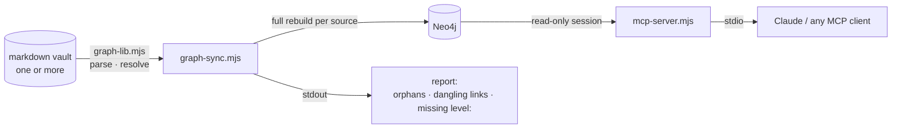

<h1 align="center">brain-graph</h1>

<p align="center">A Neo4j index over a folder of wikilinked markdown notes, with a read-only MCP server so Claude can query it.</p>

## Overview

brain-graph reads a folder of markdown notes linked with `[[wikilinks]]`. An Obsidian vault, a team wiki and
an AI agent's memory folder all fit this shape. It writes the notes and their links into Neo4j, then exposes
the graph through a read-only MCP server.

Grep answers "which files mention Acme". brain-graph answers "what is connected to Acme, and how far away is
it". Every sync also lists orphan notes, dangling links and notes missing a `level:` field.

It is for people who keep a markdown knowledge base and want an AI client to traverse it, not just search it.



## Quick start

Requires Node 20.6 or newer (for `--env-file`) and Docker.

```bash
npm install
npm run verify        # assertions against the bundled example-vault/
npm run dry           # parse example-vault/ and print the report. No database needed.
```

The dry run prints a report like this (trimmed):

```
sources      : brain
nodes        : 12  (8 governed by the orphan/level rules)
edges        : 12
orphans      : 1  (12.5% of governed)
dangling     : 1  (wikilinks pointing at nothing)
missing level: 2  (25.0% of governed)
...
DANGLING WIKILINKS (target does not exist, fix the link or write the note):
  brain:ideas/someday  ->  [[ideas/not-written-yet]]
```

Then point it at your own vault and write the graph:

```bash
cp .env.example .env            # set NEO4J_PASSWORD and GRAPH_SOURCES
npm run up                      # Neo4j 5 with APOC; browser UI on http://localhost:7474
npm run sync
```

> **Sync is a full rebuild.** It deletes every node whose `source` matches a name in
> `GRAPH_SOURCES` and writes them again. Do not share a source name with anything else
> living in the same database.

## Connect Claude

Add the server to `.mcp.json` (Claude Code) or your client's MCP config:

```json
{
  "mcpServers": {
    "brain-graph": {
      "command": "node",
      "args": ["/path/to/brain-graph/mcp-server.mjs"]
    }
  }
}
```

It reads `NEO4J_PASSWORD` from the environment or from the `.env` file beside it.

| Tool | What it answers |
|---|---|
| `entity_neighbors` | Everything within 1 to 3 hops of a note |
| `shortest_path` | How two notes relate, as a chain of slugs |
| `find_orphans` | Notes with no links in or out |
| `recent_by_type` | Most recently updated notes with a given label |
| `graph_stats` | Counts by label and edge type, orphans, notes missing `level:` |
| `query_graph` | Any read-only Cypher |

Every Cypher statement is checked for write clauses before it reaches the driver, and the
session is opened in read mode.

## Configuration

Set these in `.env`. Names only here; never commit real values.

| Variable | Required | Default | Purpose |
|---|---|---|---|
| `NEO4J_PASSWORD` | yes | none | Password for the `neo4j` user. Used by Docker Compose, `graph-sync` and the MCP server. |
| `NEO4J_URI` | no | `bolt://localhost:7687` | Bolt address of the Neo4j instance. |
| `NEO4J_USER` | no | `neo4j` | Neo4j user name. |
| `GRAPH_SOURCES` | no | bundled `example-vault` | Comma-separated `name=path` pairs. Each name becomes the `source` of its nodes. |
| `GRAPH_GENERATED` | no | none | Slugs of machine-generated notes, exempt from the orphan and `level:` rules. |
| `GRAPH_DATA_DIR` | no | `./.neo4j` | Where the Neo4j container keeps its data. Keep it outside any synced folder. |

## What becomes a node and an edge

- **Nodes.** Every `.md` file, keyed by its path without the extension (`builds/example-app`).
  Its label comes from frontmatter `type:`, or failing that from its top folder
  (`people/` becomes `Person`, `companies/` becomes `Company`; the table is `FOLDER_TYPE` in
  `graph-lib.mjs`). `INDEX.md` files are labelled `Index`. Scripts (`.sh`, `.mjs`, `.ps1`)
  under `systems/` or `scripts/` become nodes too, so links to them resolve.
- **`LINKS_TO` edges.** Every `[[wikilink]]` in a note's body. Links inside code spans,
  fenced blocks and HTML comments are ignored, so a note that documents the link syntax
  does not link to a note called "wikilink".
- **Typed edges.** `company:` becomes `WORKS_AT`, `client:` becomes `FOR_CLIENT`, `supersedes:`
  becomes `SUPERSEDES`, and `uses_skill:` becomes `USES_SKILL`. A field only becomes an edge when its
  value is written as a wikilink (`company: "[[companies/acme]]"`). `client: internal` stays plain text.
- **Resolution.** For each link the resolver tries, in order: the exact slug, a case-insensitive match,
  an alias declared on the target (`aliases:`, `alias:` or `slug:`), the folder's `README`, `INDEX` or
  `SKILL` note, then a basename that matches exactly one note. When two notes match, the link is reported
  as dangling rather than guessed, because a wrong edge is worse than a reported one.
- **Exempt from the rules.** `skills/**`, anything with a `_`-prefixed path segment, and the slugs in
  `GRAPH_GENERATED` are indexed but never reported as orphans or as missing `level:`. Dot-folders are not
  read. `archive/agent-outputs/` and `backups/` are indexed as single nodes, and their contents are never parsed.

Each vault in `GRAPH_SOURCES` is resolved on its own. A link in one vault never resolves to a note in another.

## Design notes

- **The markdown is the source of truth.** The graph is derived from it and rebuilt from scratch on every
  sync. If the graph and the files disagree, run the sync again rather than editing the graph. This is why
  the MCP server cannot write.
- **No YAML dependency.** The frontmatter reader handles flat `key: value` pairs and lists, which covers
  how notes are actually written.
- **CRLF is tested.** In JavaScript, `$` does not match before a `\r`. A regex-based frontmatter parser
  returned nothing for every CRLF file and reported no error, so a vault checked out on Windows gave
  different answers than on Linux. `verify.mjs` checks that both line endings parse identically, and
  `.gitattributes` keeps the CRLF fixture CRLF.

## Project structure

```
brain-graph/
├── graph-lib.mjs       # Parsing, link resolution and node/edge mapping
├── graph-sync.mjs      # Full rebuild of the graph, and the report
├── mcp-server.mjs      # Read-only MCP server (stdio)
├── verify.mjs          # Assertions run against example-vault/
├── docker-compose.yml  # Neo4j 5 with APOC
├── example-vault/      # Bundled sample vault used by verify and dry run
└── .env.example
```

## Testing

```bash
npm run verify
```

`verify.mjs` runs its assertions against `example-vault/`, covering parsing, link resolution, LF and CRLF
handling and the report. It does not need a running Neo4j instance.

## Contributing

Issues and pull requests are welcome. Please run `npm run verify` before opening a pull request.

## License

Released under the MIT License. See [LICENSE](LICENSE).
Built by [Dime Data](https://dimedata.cloud).
